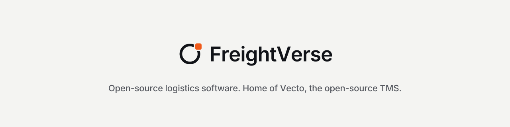

  <picture>
    <source media="(prefers-color-scheme: dark)" srcset="assets/freightverse-profile-banner-dark.svg">
    
  </picture>

FreightVerse builds open-source software for logistics: brokers, shippers, carriers and 3PLs.
Everything we ship is open source, self-hostable and API-first.

### Products

| | Product | What it is |
|---|---|---|
|  | **[Vecto](https://github.com/Freight-Verse/vecto)** | The open-source TMS, built on Frappe and ERPNext. MCP-first, with a built-in chat assistant. |

### Get involved
- Read the [contributing guide](https://github.com/Freight-Verse/vecto/blob/main/CONTRIBUTING.md) and pick a [good first issue](https://github.com/Freight-Verse/vecto/issues?q=is%3Aopen+label%3A%22good+first+issue%22).
- Follow the [roadmap](https://github.com/Freight-Verse/vecto/milestones).
- Report security issues privately — see [SECURITY.md](https://github.com/Freight-Verse/vecto/blob/main/SECURITY.md).
